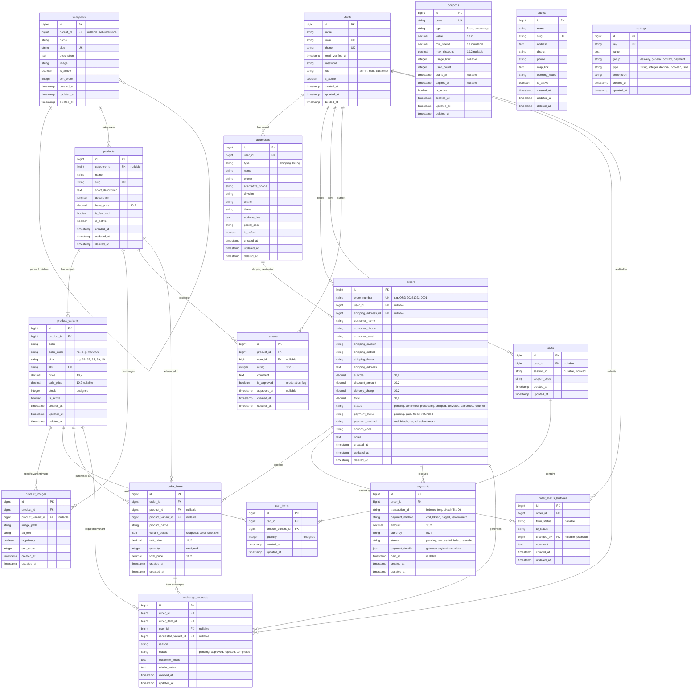

# Database Entity Relationship Diagram (ERD)

This document provides the complete database schema design and entity relationships for the **[BRAND_NAME]** women's footwear eCommerce platform in Bangladesh.

---

## 1. Visual Entity Relationship Diagram (Mermaid)

---

## 2. Table Specifications & Standards

### 2.1 Currency & Financials
- All monetary amounts (`base_price`, `price`, `sale_price`, `subtotal`, `discount_amount`, `delivery_charge`, `total`, `amount`) are strictly defined as **`DECIMAL(10, 2)`** to prevent floating point inaccuracies.
- Currency is normalized to **BDT (Bangladeshi Taka)**.

### 2.2 Slugs & Unique Constraints
- `categories.slug`: Unique index.
- `products.slug`: Unique index.
- `product_variants.sku`: Unique index.
- `outlets.slug`: Unique index.
- `coupons.code`: Unique index.
- `orders.order_number`: Unique index (format `ORD-YYYYMMDD-XXXX`).
- `settings.key`: Unique index.
- `cart_items`: Unique composite key on `[cart_id, product_variant_id]`.

### 2.3 Indexes & Performance Optimization
- **Products**: Indexed on `[category_id, is_active]`, `[is_featured]`.
- **Product Variants**: Indexed on `[product_id, is_active]`, `[product_id, color, size]`.
- **Orders**: Indexed on `[user_id, status]`, `[created_at, status]`, `[customer_phone]`, `[shipping_district]`.
- **Reviews**: Indexed on `[product_id, is_approved, rating]`.
- **Outlets**: Indexed on `[district, is_active]`.

### 2.4 Soft Deletes
Soft deletes (`deleted_at`) are sensible and enabled on:
- `users`
- `categories`
- `products`
- `product_variants`
- `addresses`
- `coupons`
- `orders`
- `outlets`

### 2.5 Localized Bangladesh Context
- **Addresses & Orders**: Partitioned into `division`, `district`, and `thana/upazila` to seamlessly integrate with local logistics APIs (Steadfast, Pathao, RedX, Paperfly).
- **Settings**: Localized defaults for inside Dhaka (`৳ 70`), Dhaka suburbs (`৳ 100`), and outside Dhaka (`৳ 130`).
